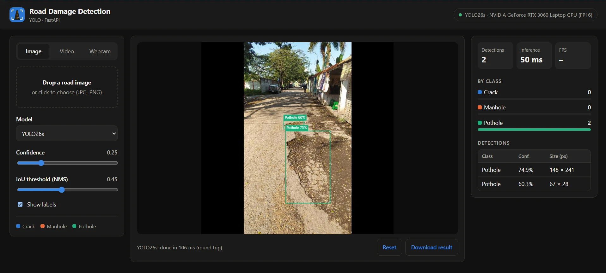
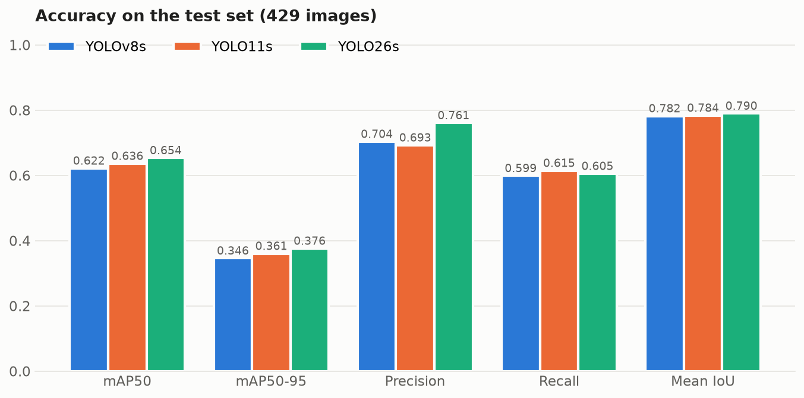
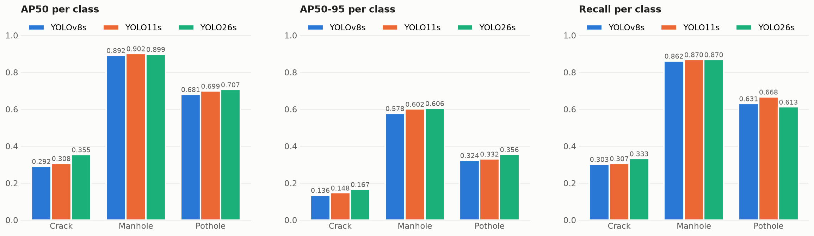
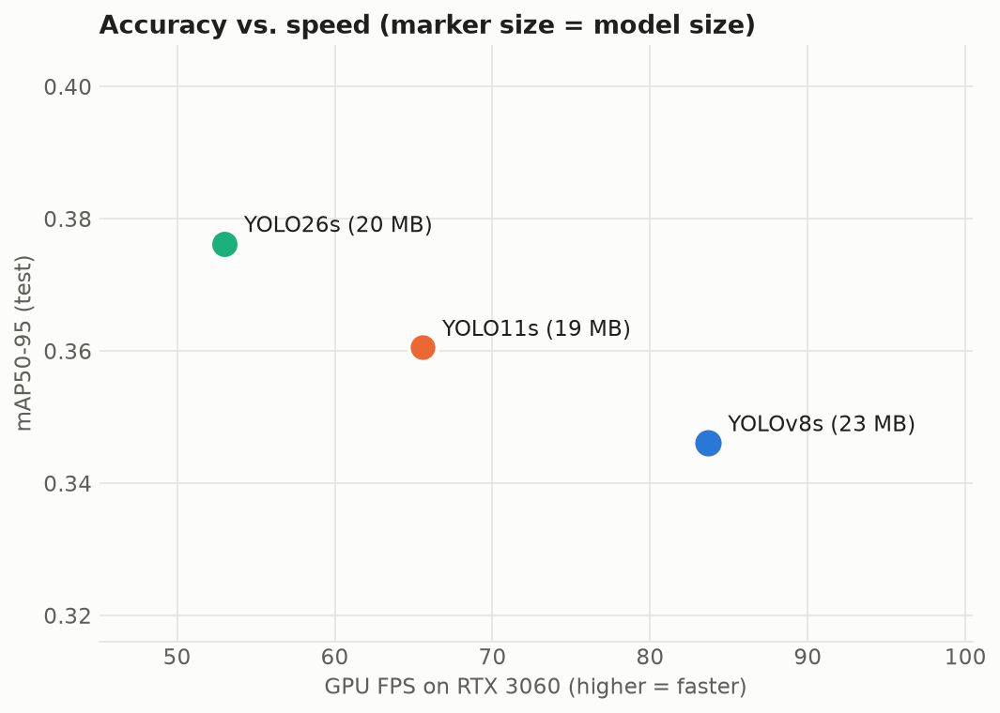
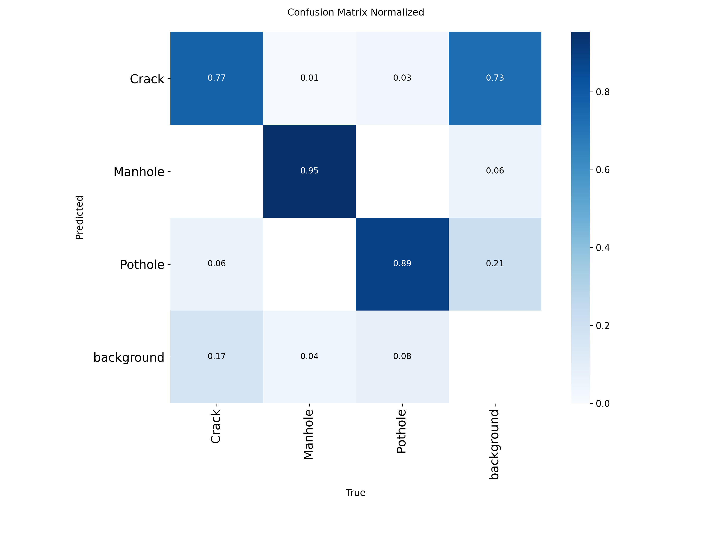
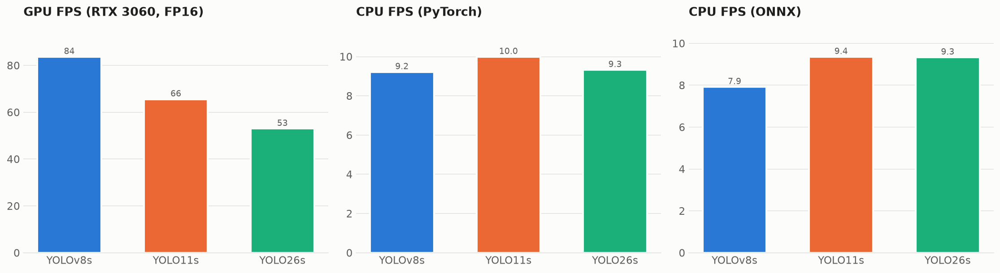
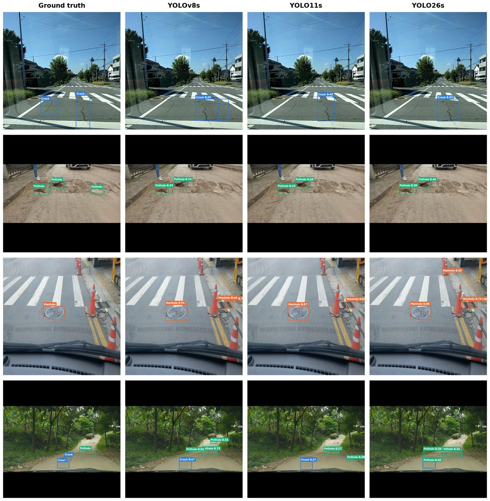

<p align="center">
  
</p>

<h1 align="center">Road Damage Detection</h1>

<p align="center">
  Detecting <b>cracks</b>, <b>potholes</b> and <b>manholes</b> in road images with YOLO —<br>
  three model generations trained, compared on the same data and hardware, and deployed with FastAPI.
</p>

<p align="center">
  
</p>

## Highlights

| | |
|---|---|
| **Models** | YOLOv8s · YOLO11s · **YOLO26s** — same data, same training settings |
| **Best model** | **YOLO26s**: mAP50 **0.654**, mAP50-95 **0.376**, precision **0.761** on 429 unseen test images |
| **Speed** | 53–84 FPS on an RTX 3060 Laptop GPU (FP16, batch 1); real time for all three models |
| **Deployment** | FastAPI backend + web dashboard (image, video and webcam modes, model selector) |
| **Report** | [`report/Road_Damage_Detection_Report.pdf`](report/Road_Damage_Detection_Report.pdf) |

## Results

All three models were evaluated with one script ([`evaluation/evaluate.py`](evaluation/evaluate.py)) on the **same 429 test images** and the **same machine** (RTX 3060 Laptop GPU, Intel Core i5-11400H).

| Model | mAP50 | mAP50-95 | Precision | Recall | Mean IoU | GPU FPS (FP16) | CPU FPS | ONNX CPU FPS | Size (MB) |
|---|---|---|---|---|---|---|---|---|---|
| YOLOv8s | 0.622 | 0.346 | 0.704 | 0.599 | 0.782 | **84** | 9.2 | 7.9 | 22.5 |
| YOLO11s | 0.636 | 0.361 | 0.693 | **0.615** | 0.784 | 66 | **10.0** | **9.4** | **19.2** |
| **YOLO26s** | **0.654** | **0.376** | **0.761** | 0.605 | **0.790** | 53 | 9.3 | 9.3 | 20.3 |

<p align="center"></p>

**Per class (AP50)**

| Model | Crack | Manhole | Pothole |
|---|---|---|---|
| YOLOv8s | 0.292 | 0.892 | 0.681 |
| YOLO11s | 0.308 | **0.902** | 0.699 |
| YOLO26s | **0.355** | 0.899 | **0.707** |

<p align="center"></p>

<table>
  <tr>
    <td width="50%"></td>
    <td width="50%"></td>
  </tr>
  <tr>
    <td align="center"><sub>Accuracy vs. GPU speed (marker size = model size)</sub></td>
    <td align="center"><sub>YOLO26s normalized confusion matrix (test set)</sub></td>
  </tr>
</table>

<p align="center"></p>

**Ground truth vs. predictions** (confidence ≥ 0.25):

<p align="center"></p>

### Takeaways

- **YOLO26s is the most accurate** (best mAP, precision and IoU) and gives the largest gain on the hardest class, **cracks** (+6.3 AP50 points over YOLOv8s). It is the default model of the app.
- **YOLOv8s is the fastest on the GPU** (84 FPS); **YOLO11s is the smallest** and fastest on the CPU.
- **Manholes are easy** (AP50 ≈ 0.90), potholes moderate (≈ 0.70), **cracks are hard** (≤ 0.36): thin, low-contrast shapes and inconsistent box annotations.
- **ONNX export keeps the accuracy** (mAP50-95 drop ≤ 0.008), so every model can be deployed without PyTorch.

## Dataset

Roboflow project `project-dvd12/road-damage-eul7g`, **version 3** — 3,841 images, 6,323 boxes, classes `Crack`, `Manhole`, `Pothole`.

| Split | Images | Crack | Manhole | Pothole |
|---|---|---|---|---|
| Train | 2,592 | 1,601 | 1,443 | 1,199 |
| Valid | 820 | 425 | 481 | 384 |
| Test | 429 | 267 | 192 | 331 |

Preparation: 802 images without annotations (most actually showed unlabeled manholes and potholes) were excluded, class names were unified, images were resized with *Fit (black edges)* to 640×640 (no stretching), and **no offline augmentation** was applied — augmentation is done online by Ultralytics during training.

## Training

Notebooks in [`notebooks/`](notebooks) (Kaggle or Colab, detected automatically), identical except for the model:

| Setting | Value |
|---|---|
| Epochs / early stopping | 100 / patience 20 |
| Image size · batch | 640 · 16 |
| Optimizer | AdamW, lr0 0.001, lrf 0.01, weight decay 0.0005 |
| Augmentation (online) | mosaic, horizontal flip, HSV, scale, translate |
| Hardware | NVIDIA Tesla T4 |

The dataset is downloaded from Roboflow with a secret named `ROBOFLOW_API_KEY` (Kaggle: *Add-ons → Secrets*, Colab: 🔑 *Secrets*).

## Deployment app

```
Road image / video / webcam → Web dashboard → FastAPI (POST /api/detect) → YOLO model → JSON detections
```

- All three trained models are loaded once on the GPU (FP16) or CPU; pick one in the dashboard dropdown or with the `model` field of the API.
- `GET /api/models`, `GET /api/health`, `POST /api/detect` (image + `model`, `conf`, `iou`, `imgsz`); interactive docs at `/docs`.
- Dashboard: image upload, video file and webcam (real time), confidence / IoU sliders, per-class counts, detection table, download, reset.

### Run it

```bash
cd road_damage_app
python -m venv .venv
.venv\Scripts\activate
# NVIDIA GPU (CUDA 13): use cu130; CPU only: use https://download.pytorch.org/whl/cpu
pip install torch torchvision --index-url https://download.pytorch.org/whl/cu130
pip install -r requirements.txt
python run.py
```

The dashboard opens automatically in your default browser (<http://localhost:8000>; set `OPEN_BROWSER=0` to disable). Sample test images per class are in [`sample_test/`](sample_test). More details: [`road_damage_app/README.md`](road_damage_app/README.md).

Tests: `pip install pytest httpx && pytest -q` (inside `road_damage_app`).

## Reproduce the evaluation

```bash
cd evaluation
set ROBOFLOW_API_KEY=<your key>
..\road_damage_app\.venv\Scripts\python -m pip install roboflow
..\road_damage_app\.venv\Scripts\python download_test_data.py   # test split -> data/test
..\road_damage_app\.venv\Scripts\python evaluate.py             # metrics -> results/*.json
..\road_damage_app\.venv\Scripts\python compare.py              # table, charts, ranking -> comparison/
..\road_damage_app\.venv\Scripts\python qualitative.py          # GT vs predictions figure
```

## Project structure

```
├── notebooks/            training notebooks (YOLOv8s, YOLO11s, YOLO26s) + comparison notebook
├── evaluation/           evaluate.py, compare.py, qualitative.py, results/*.json, comparison/ (tables + charts)
├── road_damage_app/      FastAPI backend + web dashboard, trained weights in models/, tests
├── report/               PDF report (+ HTML source and figures)
├── sample_test/          18 test images (5 per class + 3 mixed) with ground_truth.csv
└── docs/images/          figures used in this README
```
